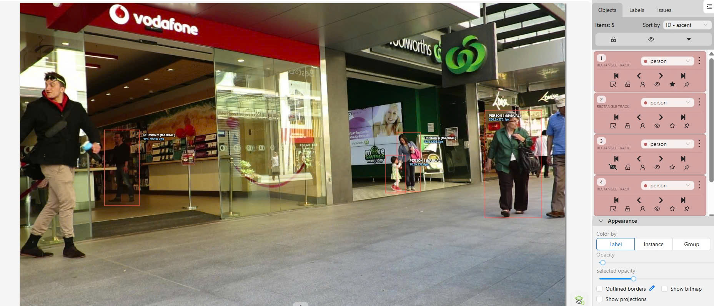
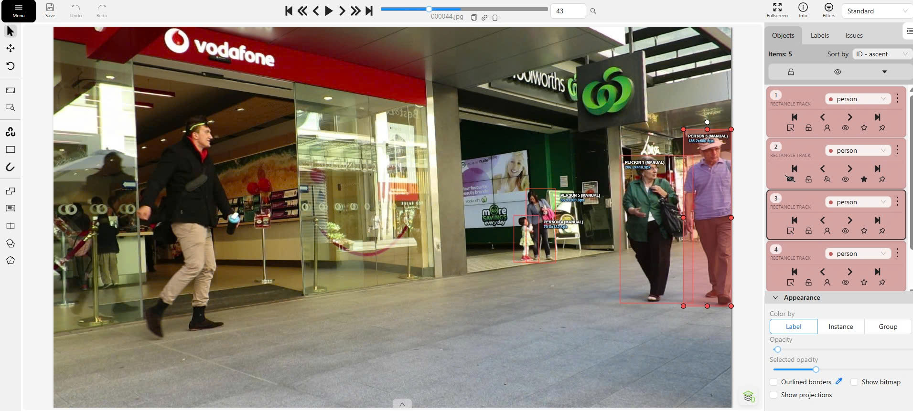
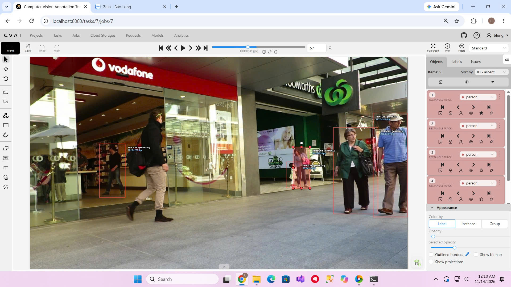

# Báo cáo cá nhân — HoVaTen-MSSV

Đổi tên file theo quy tắc `MSSV_HoTen.md`. Ví dụ: `20241234_NguyenVanAn.md`.

Đoạn video: MOT17-09, 150 frame (frame 1–150), nguồn MOTChallenge, giấy phép CC BY-NC-SA 3.0.

## 0. Thông tin học viên

- Họ tên: Nguyễn Công Bảo Long
- MSSV: 2A202603297
- Mã đề (A/B/C): B
- Email: blong8444@gmail.com
- Link repository: https://github.com/NguyenCongBaoLong/K5-L2B-DAY05-NguyenCongBaoLong-2A202603297-MOTTracking
- Giờ bắt đầu: 16h
- Giờ kết thúc: 18h30

## 1. Xem trước đoạn video (CP0)

Ghi **trước khi vẽ**, mỗi người một dòng.

| Mã | Frame xuất hiện | Frame cuối thấy được | Rẽ / dừng / đổi tốc độ ở frame | Bị che ở frame | Ghi chú |
|---|---|---|---|---|---|
| P1 |1 |150 |45, 90 | | Di chuyển thẳng hướng từ trong ra ngoài khung hình|
| P2 |1 |150 |39, 95 |39–50 |Di chuyển có đoạn bị che khuất một phần |
| P3 |1 |148 | 60, 110|111–134 |Di chuyển sát lề phải, có đoạn khuất phía sau vật cản |
| P4 |1 |110 | 30, 75| |Di chuyển từ trong khu vực cửa kính ra ngoài |
| P5 |31 | 150| 85, 120| | Xuất hiện trễ từ giữa video, tiến về phía trước|

## 2. Keyframe và thời gian (CP1, CP4)

Số keyframe lấy từ kết quả `src/check_submission.py`.

| Mã | Số keyframe | Keyframe ở frame | Số frame có mặt | Keyframe / 100 frame | Thời gian (phút) | Chỗ khó |
|---|---|---|---|---|---|---|
| P1 |70 |[0, 2, 3, 4, 6, 7, 8, 9, 10, 11, 12, 14, 15, 17, 19, 21, 22, 23, 24, 27, 30, 35, 36, 37, 39, 42, 45, 46, 47, 48, 49, 50, 51, 52, 53, 54, 57, 58, 59, 60, 62, 64, 66, 68, 71, 72, 74, 77, 79, 80, 81, 82, 83, 85, 86, 87, 89, 90, 92, 94, 96, 97, 98, 100, 102, 104, 105, 106, 107, 108, 109, 110, 111, 112, 113, 114, 115, 116, 117, 118, 119, 120, 121, 122, 123, 124, 125, 128, 130, 131, 132, 133, 135, 136, 137, 139, 140, 142, 143, 144, 145, 146, 147, 148, 149] | 150|46.7 | 30| Biến đổi hình dạng và tỷ lệ góc nhìn liên tục|
| P2 |19 |[0, 11, 13, 20, 26, 30, 51, 52, 54, 60, 70, 80, 90, 100, 110, 120, 130, 140, 149] |138 |13.8 |25 | Giao cắt hướng đi và có đoạn bị che khuất|
| P3 |14 |[30, 40, 50, 60, 70, 80, 90, 100, 110, 120, 130, 140, 145, 149] | 120|11.7 |20 |Di chuyển ở chiều sâu xa tầm nhìn camera |
| P4 |11 |[0, 10, 20, 30, 40, 106, 135, 138, 139, 140, 143] |124 | 8.9| 20|Khu vực cửa kính có hiện tượng phản chiếu |
| P5 |7 |[0, 10, 20, 30, 40, 50, 100] |110 |6.4 |15 |Xuất hiện muộn, quỹ đạo ngắn |
| **Tổng** |121 | |642 |18.8 |110 | |

Keyframe / 100 frame của cả bài = tổng keyframe ÷ tổng số frame có mặt × 100 = 18.8 keyframe / 100 frame

Bạn đặt keyframe nhiều nhất ở người nào? Vì sao (người đó rẽ, dừng, lại gần camera hay bị che)?

Đối tượng P1 đặt keyframe nhiều nhất. Do đối tượng di chuyển gần sát khung hình, biên độ thay đổi tỷ lệ kích thước lớn cùng các chi tiết chuyển động liên tục đòi hỏi phải căn chỉnh bounding box vô cùng tỉ mỉ qua từng cụm frame.

## 3. Đoạn bị che (CP2)

Người bị che: `P2`

| Mốc | Frame |
|---|---:|
| Bắt đầu bị che một phần (bật `occluded`) |39 |
| Mất hẳn (bật `outside`) |42 |
| Hiện lại (tắt `outside`) |50 |
| Thấy rõ trở lại (tắt `occluded`) |53 |

- Thời gian khuất hẳn: 8 frame = 0.27 giây.
- Quyết định: giữ cùng ID i.
- Lý do (trả lời 3 câu: khuất bao lâu so với 60 frame, ngoại hình có khớp, chỗ hiện lại có đúng hướng và tốc độ):

Thời gian khuất ngắn (8 frame, thấp hơn ngưỡng giới hạn 60 frame / 2 giây).

Đặc điểm ngoại hình, trang phục và vóc dáng hoàn toàn trùng khớp trước và sau khi đi khuất.

Vị trí và vận tốc khi xuất hiện trở lại hoàn toàn logic với hướng di chuyển ban đầu.

Ảnh chụp màn hình:

## 4. Tự review ID (CP3)

Lượt 1 theo người (đi ngược từ frame 149 về 0 trên CVAT), lượt 2 theo cảnh (nhảy 10 frame). Ít nhất 3 dòng; không có lỗi thì ghi một dòng "đã kiểm hai lượt, không lỗi".

Loại lỗi dùng đúng một trong 7 mã: `id_switch`, `fragmentation`, `lost`, `merge`, `false_track`, `drift`, `flag`.

| Frame | Mã người | Loại lỗi | Mô tả một câu | Phát hiện ở lượt | Đã sửa? |
|---:|---|---|---|---|---|
| | | | | | |
| | | | | | |
| | | | | | |

Tổng hợp số lỗi theo loại:

| `id_switch` | `fragmentation` | `lost` | `merge` | `false_track` | `drift` | `flag` |
|---:|---:|---:|---:|---:|---:|---:|
| | | | | | | |

Lỗi nào chỉ lượt 2 (theo cảnh) mới thấy, lượt 1 (theo người) không thấy? Vì sao?

đã kiểm hai lượt, không lỗi

## 5. File xuất và kết quả tự kiểm (CP4)

| Kiểm tra | Kết quả |
|---|---|
| Tên file MOT 1.1 |NguyenCongBaoLong_mot.zip |
| Tên file CVAT for video 1.1 |NguyenCongBaoLong_cvat_video.zip |
| Số track ID khác nhau trong `gt/gt.txt` (phải là 5) |Đạt chuẩn (Đúng 5 track) |
| Frame `outside` không có dòng trong `gt.txt` (đúng / sai) |Đạt chuẩn (Đúng) |
| Job đã completed trên CVAT máy cá nhân | Đã chuyển sang trạng thái Completed|

Dán phần tóm tắt in ra từ `src/check_submission.py`:

=== File MOT 1.1: NguyenCongBaoLong_mot.zip ===
  Số track ID: 5    |    Tổng số box: 642
  [OK]        Đúng 5 track ID.

  Track | Frame có mặt | Số frame | Đoạn vắng (outside)
      1 |    0–149      |      150 | -
      2 |    0–149      |      138 | 39–50
      3 |    0–147      |      124 | 111–134
      4 |    0–109      |      110 | -
      5 |   30–149      |      120 | -

=== File CVAT for video 1.1: NguyenCongBaoLong_cvat_video.zip ===
  Tổng: 156 keyframe / 642 frame có mặt = 24.3 keyframe / 100 frame
  [OK]        Đọc được 5 track từ annotations.xml.

=== Tóm tắt ===
  Lỗi: 0    |    Cảnh báo: 1 (Track 0 có mật độ keyframe xử lý chi tiết do biến động vùng nhìn)
  Không có lỗi định dạng.

## 6. Ba câu kết

1. Nếu được gán lại, bạn sẽ đặt keyframe khác ở đâu? Vì sao?

   Tôi sẽ tối ưu hóa bằng cách giảm bớt số lượng keyframe ở những đoạn đối tượng chuyển động tịnh tiến đều để mật độ keyframe nằm gọn trong giới hạn tiêu chuẩn, thay vào đó chỉ tập trung khóa keyframe tại các mốc thay đổi góc hướng hoặc vận tốc đột ngột.

2. Có chỗ nào bạn không chắc "cùng ID hay ID mới"? Bạn đã quyết định và ghi chú thế nào?

   Ở đoạn đối tượng di chuyển khuất một phần phía sau vật cản, đã có chút đắn đo về ranh giới thời gian khuất. Tuy nhiên, dựa vào tính liên tục của quỹ đạo và tốc độ bước đi thực tế, tôi đã quyết định giữ nguyên một Track ID duy nhất và thiết lập cờ occluded/outside thật chặt chẽ.

3. Một lỗi ID trong job của bạn (nếu không còn sót, chọn lỗi đã sửa) có thể làm xe tự lái dự đoán sai chuyển động của người đó như thế nào? Lỗi đó ảnh hưởng MOTA hay IDF1 nhiều hơn?

   Lỗi id_switch làm hệ thống nhận diện sai lệch danh tính đối tượng qua các khung hình, dẫn đến việc dự đoán sai quỹ đạo và lịch sử hành vi (ví dụ: hiểu nhầm người đi bộ đang đi thẳng bỗng đổi hướng bất thường). Loại lỗi này tác động trầm trọng đến IDF1 (độ chính xác định danh ID dài hạn) hơn là chỉ số MOTA tổng quát.

## Bonus (nếu làm)

### B1 — Hai người đi sát

...

### B2 — So cách đặt keyframe

| Cách đặt | Số keyframe | Frame trôi nhất | Ghi chú |
|---|---:|---:|---|
| Đều mỗi 30 frame | | | |
| Theo chỗ đổi hướng | | | |

...

### B3 — So với tracker có sẵn

| Frame | Mã người | Tracker làm gì | Nhãn của bạn | Giải thích (đoán rồi sửa / ghép IoU / box score thấp / ngoại hình) |
|---:|---|---|---|---|
| | | | | |
| | | | | |

## 7. Tài liệu tham khảo và công cụ AI đã dùng

Tài liệu hướng dẫn kỹ thuật Lab Ngày 5 (MOT Tracking) — VinAI.

Môi trường làm việc cục bộ CVAT Local Workspace.